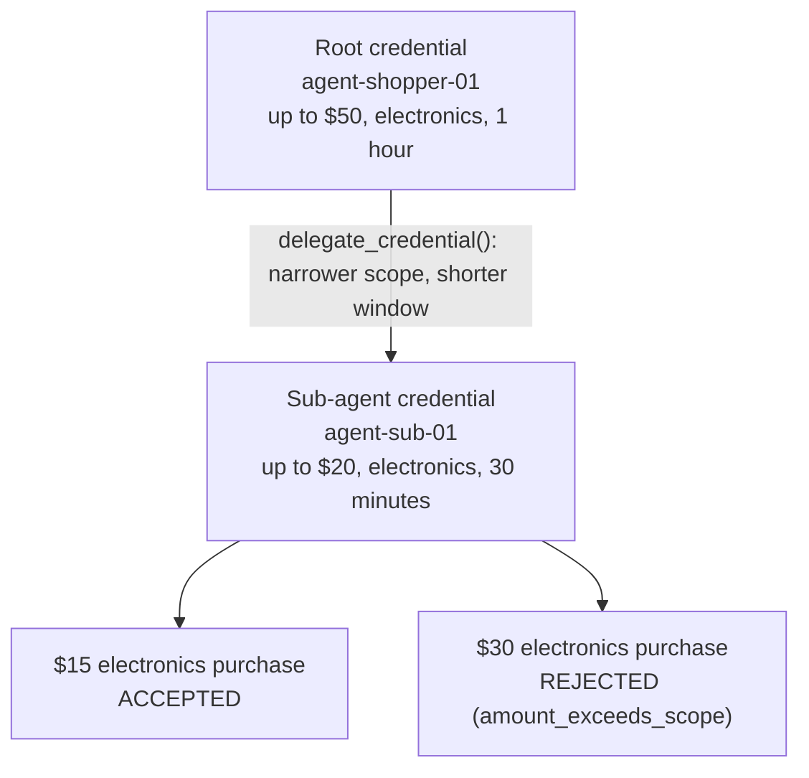

# Know Your Agent (KYA)

[](https://github.com/RishabhPande/know-your-agent/actions/workflows/tests.yml)
[](https://codespaces.new/RishabhPande/know-your-agent)

AI agents now shop, book, and pay on behalf of humans, but fraud systems still
see only a human account behind the transaction. When an agent acts, nobody can
answer three questions cryptographically: which agent is this, who authorized
it, and what exactly is it allowed to do?

Know Your Agent (KYA) gives every agent transaction a verifiable identity:
scoped, session-limited, and revocable. A credential binds an agent ID to a
human principal, a scope, and a session window, and is signed with Ed25519.
Verification fails closed: anything unverifiable is rejected, with a reason
code, instead of raising or passing silently.

## Quickstart

Runs in minutes. No servers, no accounts, no real money.

```bash
git clone https://github.com/RishabhPande/know-your-agent.git
cd know-your-agent
pip install -r requirements.txt
python demo.py
```

Expected output:

```
Issued credential for agent-shopper-01 (principal user-123).
Scope: up to $50 in electronics. Session: 1 hour.

1. $30 electronics purchase: ACCEPTED (allowed)
2. $500 electronics purchase: REJECTED (amount_exceeds_scope)
3. $30 groceries purchase: REJECTED (category_not_allowed)
4. $30 electronics purchase after revocation: REJECTED (revoked)
5. Tampered credential (agent id changed): REJECTED (bad_signature)
6. Delegated chain (root -> sub-agent, $20): ACCEPTED (ok)
7. $15 electronics purchase via sub-agent: ACCEPTED (allowed)
8. $30 electronics purchase via sub-agent (over leaf limit): REJECTED (amount_exceeds_scope)
9. Audit log (3 entries) verifies: ACCEPTED (ok)
10. Tampered audit entry (outcome rewritten): REJECTED (bad_hash_chain)
11. Benchmark (toy model, 3 scored, 1 ambiguous excluded): precision 1.00, recall 1.00, AUC 1.00
12. AgentRisk Legacy (9 cells): precision 0.75, recall 1.00, AUC 0.89
12. AgentRisk AgentGate (9 cells): precision 1.00, recall 1.00, AUC 1.00
13. AgentRisk Legacy per seed (5 seeds): mean AUC 0.89, 95% CI [0.89, 0.89]
13. AgentRisk AgentGate per seed (5 seeds): mean AUC 1.00, 95% CI [1.00, 1.00]
```

Run the tests with:

```bash
python -m pytest tests/ -q
```

## Credential format

A credential is plain JSON with three keys: the payload, a base64url Ed25519
signature over the canonical payload (sorted keys, no whitespace), and the
algorithm name.

```json
{
  "payload": {
    "version": 1,
    "credential_id": "9f2c... (unique id; the revocation handle)",
    "agent_id": "agent-shopper-01",
    "principal": "user-123",
    "issuer": "kya",
    "scope": {"max_amount_usd": 50.0, "categories": ["electronics"]},
    "not_before": "2026-10-27T00:00:00Z",
    "not_after": "2026-10-27T01:00:00Z",
    "issued_at": "2026-10-27T00:00:00Z"
  },
  "signature": "BASE64URL_ED25519_SIGNATURE",
  "algorithm": "Ed25519"
}
```

Field notes:

- `credential_id` is unique per credential and serves as the revocation
  handle for `RevocationList`.
- `scope` describes what the agent may do. v0.1 supports purchase scope
  (`max_amount_usd`, `categories`); the shape is extensible.
- Times are UTC ISO 8601 strings. The session window is enforced at
  verification time.

## API

```python
from kya import (
    authorize_purchase,
    generate_keypair,
    issue_credential,
    verify_credential,
)

private_key, public_key = generate_keypair()
credential = issue_credential(
    private_key,
    agent_id="agent-shopper-01",
    principal="user-123",
    scope={"max_amount_usd": 50.0, "categories": ["electronics"]},
    not_before="2026-10-27T00:00:00Z",
    not_after="2026-10-27T01:00:00Z",
)

ok, reason = verify_credential(public_key, credential)
ok, reason = authorize_purchase(public_key, credential, 30.0, "electronics")
```

`verify_credential` returns `(True, "ok")` or `(False, reason)`, checked in
this order: `malformed`, `unsupported_algorithm`, `bad_signature`,
`revoked`, `expired` / `not_yet_valid`, `bad_scope`. It accepts an
optional `revoked_ids` argument: either a plain set of ids or a
`RevocationList` (see below). A credential whose id is revoked is
rejected as `revoked`, even inside its session window, and revocation
beats expiry in the check order.

`authorize_purchase` combines verification with a scope check and returns
`(True, "allowed")` only when both pass, otherwise the verification reason
or a scope reason: `amount_exceeds_scope`, `category_not_allowed`,
`no_purchase_scope`, `invalid_amount`.

## Delegation chains

An agent may delegate a subset of its authority to a sub-agent with
`delegate_credential()`. The delegated credential links back to its parent
via `delegated_from` (parent `credential_id`) and `delegator_agent_id`
(parent `agent_id`), keeps the same principal and issuer, and must narrow
the scope and shrink the session window - `delegate_credential()` raises
`ValueError` on any widening. `verify_chain()` walks `[root, ..., leaf]`
and fails closed: every link must verify individually, links must connect,
the principal must not change, windows may only shrink, and scopes may
only narrow, with reasons `bad_chain`, `principal_mismatch`,
`window_widened`, and `scope_widened`. `authorize_purchase_chain()`
verifies the chain and checks the purchase against the leaf's scope, so a
$30 purchase that the root allows is still rejected when the leaf's limit
is $20.

```python
from kya import delegate_credential, verify_chain, authorize_purchase_chain

delegated = delegate_credential(
    private_key,
    credential,
    agent_id="agent-sub-01",
    scope={"max_amount_usd": 20.0, "categories": ["electronics"]},
    not_before="2026-10-27T00:00:00Z",
    not_after="2026-10-27T00:30:00Z",
)
ok, reason = verify_chain(public_key, [credential, delegated])
ok, reason = authorize_purchase_chain(
    public_key, [credential, delegated], 15.0, "electronics"
)
```



*The chain from `demo.py` (steps 6 to 8). The $30 purchase fits the root's $50 limit but not the leaf's $20 limit, so the chain rejects it.*

## Revocation management

Saved revocation JSON rejects duplicate keys, including inside entries, and requires an integer format version. Ambiguous input is an error rather than silently replacing recorded revocations.

`RevocationList` owns the revoked ids, so no caller has to maintain a set
by hand. Revoke by id or straight from a credential, pass the list itself
to any verify or authorize call, and save it to disk as JSON when it
needs to survive a restart. Revocation is permanent: there is no unrevoke,
so a mistaken revocation is fixed by issuing a fresh credential, not by
resurrecting the old one. Revoking any link in a delegation chain fails
the whole chain, root or leaf.

```python
from kya import RevocationList, verify_credential

revocations = RevocationList()
revocations.revoke_credential(credential, reason="reported stolen")
ok, reason = verify_credential(public_key, credential, revoked_ids=revocations)
# (False, "revoked")

saved = revocations.to_json()
restored = RevocationList.from_json(saved)
assert restored.is_revoked(credential["payload"]["credential_id"])
```

Re-revoking an id is a harmless no-op that returns `False` and keeps the
original entry, so repeated calls never rewrite history. Loading
validates strictly and raises `ValueError` on a bad version, a duplicate
id, or a malformed entry, instead of silently dropping entries.

## Audit trail

`AuditLog` records issuance, verification, and revocation as a signed,
hash-chained log, so a disputed transaction can be reconstructed from
the record instead of argued about. Each entry links to the previous
entry's hash and carries its own hash plus an Ed25519 signature, so
inserting, deleting, reordering, or editing a middle entry breaks the
chain, and a forged signature fails verification outright. `verify`
returns `(True, "ok")` or `(False, reason)` with reasons `malformed`,
`bad_index`, `bad_hash_chain`, and `bad_signature`, in that order.

```python
from kya import AuditLog

audit = AuditLog(private_key)
audit.record_issued(credential)
ok, reason = verify_credential(public_key, credential)
audit.record_verified(credential, ok, reason)
audit.record_revoked(credential, reason="reported stolen")
ok, reason = audit.verify(public_key)
# (True, "ok")

saved = audit.to_json()
restored = AuditLog.from_json(saved)
assert restored.verify(public_key) == (True, "ok")
```

Two honest limits. First, dropping entries from the tail still
verifies, because a shorter chain is still a valid chain, so anchor the
latest hash somewhere the auditor cannot rewrite (a timestamped post, a
second store, a periodic commit) and pass it as
`expected_last_hash` to `verify`: a truncated log then fails. Second,
the log proves the recorded history was not altered, not that the
history is complete: an event nobody recorded leaves no trace. The log
is append-only by construction, with no delete, truncate, or edit
method, and loading checks shape only, so always call `verify` before
trusting a loaded log. In the demo the issuer key signs the log for
simplicity; a real deployment should use a separate audit key.

## Benchmark hook

Every verification ends in a verdict, and that verdict is a ground-truth
label for the transaction it judged. `kya/benchmark.py` turns those
labels into a fraud-model scorecard: a credential that verifies (or a
purchase inside its scope) is legitimate, a credential rejected for a
credential reason (revoked, bad signature, expired, and so on) is a
fraud attempt, and a purchase-policy rejection (over the scope limit, a
category outside the scope) is ambiguous and excluded from the metrics,
counted separately.

```python
from kya import make_record, records_from_audit, score_model

records = [
    make_record(0.95, "revoked"),
    make_record(0.10, "ok"),
]
result = score_model(records)
# {"precision": 1.0, "recall": 1.0, "f1": 1.0, "accuracy": 1.0,
#  "auc": 1.0, "tp": 1, "tn": 1, "fp": 0, "fn": 0, ...}
```

`records_from_audit` builds records straight from an `AuditLog`:
hand it the log entries and a dict mapping credential id to the model's
score for that transaction, and it pairs them up, counting entries with
no score instead of guessing one. AUC is computed by the rank method in
pure Python, with ties as half wins, and comes back as `None` when the
records hold only one class, rather than a made-up number. The service
exposes the same scoring at `POST /benchmark`. The record format is
documented in `kya/benchmark.py` so other traffic sources can convert
to it.

## AgentRisk link-up

The first real traffic for the hook comes from the AgentRisk results
dataset (RishabhPande/agentrisk on Hugging Face): 18 rows, 2 policies
(Legacy, AgentGate) by 9 session classes, with each cell's mean decline
rate across 5 seeds. `kya/agentrisk.py` converts those cells into
benchmark records: the policy's decline rate for a class is its score,
and the class ground truth is the label (H, AU, AV legitimate; FH, FB,
FAU, FAV, FHJ, FSP fraud). Each fraud class maps to the KYA reason that
best describes how a KYA check would fail it (spoofed signature to
`bad_signature`, hijacked agent to `revoked`, and so on); the mapping is
documented in the module. One honest caveat: a cell is an aggregate,
not a transaction, so the numbers measure how well a policy's decline
behavior separates fraud classes from legitimate classes at the class
level, not per-transaction discrimination.

```python
from kya import load_agentrisk_csv, bundled_results_path, score_agentrisk_policy

rows = load_agentrisk_csv(bundled_results_path())
records, counts, result = score_agentrisk_policy(rows, "AgentGate")
# {"precision": 1.0, "recall": 1.0, "auc": 1.0, "tp": 6, "fp": 0, ...}
```

`bundled_results_path()` points at a snapshot of the published file
shipped with the package (`kya/agentrisk_results.csv`, copied
2026-11-07), so the demo and tests run offline. For fresh numbers,
download `data/results.csv` from the dataset and load that file with
`load_agentrisk_csv` instead. Per-seed rows from the AgentRisk repo's
`results/main.csv` work too: they carry `decline` as a fraction and a
`seed` column, and `records_from_agentrisk` accepts an optional seed
filter. The demo's step 12 scores both policies on the snapshot:
Legacy lands at precision 0.75 and AUC 0.89 (it false-declines the
legitimate agent classes), AgentGate at precision 1.00 and AUC 1.00.

### Per-seed scoring with confidence intervals

A headline from the means file cannot say whether the number is
stable or a one-seed artifact. `score_agentrisk_policy_per_seed`
scores each seed separately and summarizes every metric (precision,
recall, F1, accuracy, AUC) with a Student's t confidence interval,
so the headline comes with its spread. It needs rows with a `seed`
column; `bundled_per_seed_results_path()` points at a snapshot of
`results/main.csv` from the AgentRisk repo (`kya/agentrisk_per_seed_results.csv`,
copied 2026-11-09: 495 rows, 5 seeds, 11 policies). A metric
undefined on a seed (no fraud to find, say) is left out of that
metric's summary and counted, never treated as zero.

```python
from kya import load_agentrisk_csv, bundled_per_seed_results_path
from kya import score_agentrisk_policy_per_seed

rows = load_agentrisk_csv(bundled_per_seed_results_path())
per_seed, summary = score_agentrisk_policy_per_seed(rows, "Legacy")
# summary["metrics"]["auc"] is {"n": 5, "mean": 0.889, "std": 0.0,
#   "ci_low": 0.889, "ci_high": 0.889, ...}
```

On this snapshot both policies are identical on every seed at
threshold 0.5, so their 95 percent intervals have zero width. The
decline rates do vary by seed (88 of 99 cells), but none of that
variation crosses the threshold, so the honest reading is that the
headline is seed-stable, not seed-sensitive. The demo's step 13
prints the per-seed mean AUC with its interval for both policies.
Both scorings are also served over HTTP at
`POST /benchmark/agentrisk` (see the service section below): send
`{"policy": "Legacy"}` for the bundled headline, or add
`"per_seed": true` for the per-seed summary.

## FastAPI demo service

`service/app.py` puts the same checks behind HTTP, so a merchant can
try the flow without writing Python. The service holds no private key
and issues nothing: it trusts one issuer public key given at startup,
checks a `RevocationList`, and records verifications in an `AuditLog`
when one is configured.

```bash
pip install -r requirements.txt
python -m service.demo
```

That prints a sample credential (valid about an hour, only against
that running demo) and serves on http://127.0.0.1:8000. Then:

```bash
curl -X POST http://127.0.0.1:8000/verify \
  -H 'Content-Type: application/json' \
  -d '{"credential": CREDENTIAL_JSON}'

curl -X POST http://127.0.0.1:8000/checkout \
  -H 'Content-Type: application/json' \
  -d '{"credential": CREDENTIAL_JSON, "amount_usd": 30.0, "category": "electronics"}'
```

Endpoints: `GET /health`, `POST /verify`, `POST /verify-chain`,
`POST /checkout`, `POST /revoke` (by credential id, or by full
credential, which also lands in the audit log), `GET /audit`
(entries plus their verification result, when a log is configured),
`POST /benchmark` (score a list of KYA-labeled records, with an
optional `threshold`, default 0.5; a malformed record is a 422), and
`POST /benchmark/agentrisk` (score one AgentRisk policy by name, with
optional caller-supplied `rows`; when `rows` is omitted the bundled
snapshot is scored, and with `per_seed` set each seed is scored
separately with confidence intervals from the bundled per-seed
snapshot; a malformed row, an unknown policy, or a bad option is a
422).
A verify or checkout answer is `{"ok": true, "reason": "ok"}` or
`{"accepted": true, "reason": "allowed"}` on success, and the
fail-closed reason otherwise: `malformed`, `bad_signature`, `revoked`,
`expired`, `amount_exceeds_scope`, `category_not_allowed`, and so on.
A malformed credential is a rejection with a reason, never a 500, and
never an acceptance. To embed the service in your own app instead of
the demo, call `create_app(public_key, revocations=..., audit=...)`
from `service.app` and serve the result with uvicorn. Invalid revocation
identifiers, including empty IDs in either request form, return 422 without
changing revocation or audit state. Revocation state
belongs to each app instance: two apps built without a shared list do
not share revocations, which the tests pin down.

## Security notes

- Fail closed, everywhere: unverifiable input is rejected, never accepted
  on a best effort basis.
- Demo keys are generated in memory and discarded on exit. Never reuse demo
  keys for real authorization, and never commit private keys to a repo.
- Ed25519 only. There is no password, token, or shared-secret path.
- Everything runs offline and deterministically; there is no network call
  in the issue, verify, or authorize path.

## What comes next

v0.1 is the core: credential model, issue and verify, purchase policy, demo,
and tests. Delegation chains, revocation management, the audit trail, the
FastAPI demo service, the benchmark hook, and the AgentRisk link-up have all
shipped since (see above). Per-seed AgentRisk scoring with confidence
intervals shipped 2026-11-09, and the `POST /benchmark/agentrisk`
endpoint shipped 2026-11-11, so the backlog is now complete and the
next loop has one uncommitted candidate left: a `POST /checkout-chain`
endpoint, so a purchase can be authorized against the leaf of a
delegation chain over HTTP the way `authorize_purchase_chain()` already
allows in the library.

## License

MIT. See LICENSE.
